# Ticket 010 Diagrams

*Added November 27, 2026, after the ticket's technical work was completed. This file is a summary, not part of the original evidence, and is not listed in the ticket's manifests.*

These diagrams summarize the [Ticket 010 README](README.md) and its evidence. They are kept in a separate file because the README is listed in the ticket's integrity manifest.

## Release Controls Built in This Ticket

A Deployment with a mutable image tag and a privileged root container passed Kubernetes schema validation. Each version added a layer that can stop it:

```mermaid
flowchart LR
    D["Deployment change<br/>(mutable tag, privileged,<br/>runs as root)"]
    subgraph v1["V1: pipeline gates"]
        P1["Configuration<br/>policy checks"]
        P2["Trivy image<br/>vulnerability scan"]
    end
    subgraph v3["V3: artifact integrity"]
        A1["Image pinned<br/>by digest"]
        A2["Syft SBOM"]
        A3["cosign signature<br/>and trusted signer"]
        A4["Vulnerability<br/>release decision"]
    end
    subgraph v2["V2: Kubernetes admission"]
        K1["Pod Security Admission<br/>(restricted)"]
        K2["ValidatingAdmissionPolicy<br/>image-reference check"]
    end
    R["Release decision<br/>and rollback rehearsal"]
    D --> P1 --> P2 --> A1 --> A2 --> A3 --> A4 --> K1 --> K2 --> R
```

## Adversarial Test Results

The consolidated matrix ([`tests/adversarial-test-matrix.md`](tests/adversarial-test-matrix.md)) has 13 scenarios: 12 have verified supporting outcomes, and A02 remains under review because the record does not prove that its exact fixture was blocked by the release gate. Production readiness is not established.
