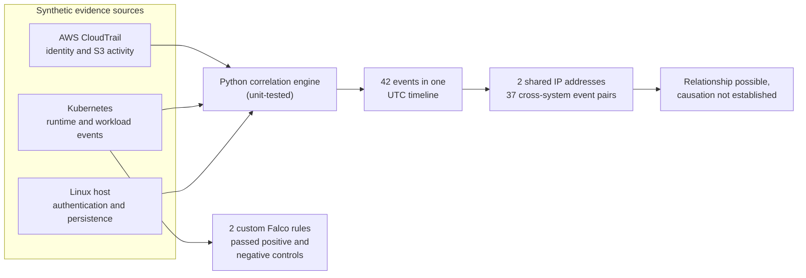

# Ticket 011 Diagrams

*Added November 27, 2026, after the ticket's technical work was completed. This file is a summary, not part of the original evidence, and is not listed in the ticket's manifests.*

This diagram summarizes the [Ticket 011 README](README.md) and its incident report. It is kept in a separate file because the README is listed in the ticket's submission evidence manifest.

## How the Three Evidence Sources Were Correlated

Shared IPs and close timestamps were treated as leads, not proof: the ticket's rule is not to infer causation from timestamps alone. Technical review acceptance and formal closure are still pending.
