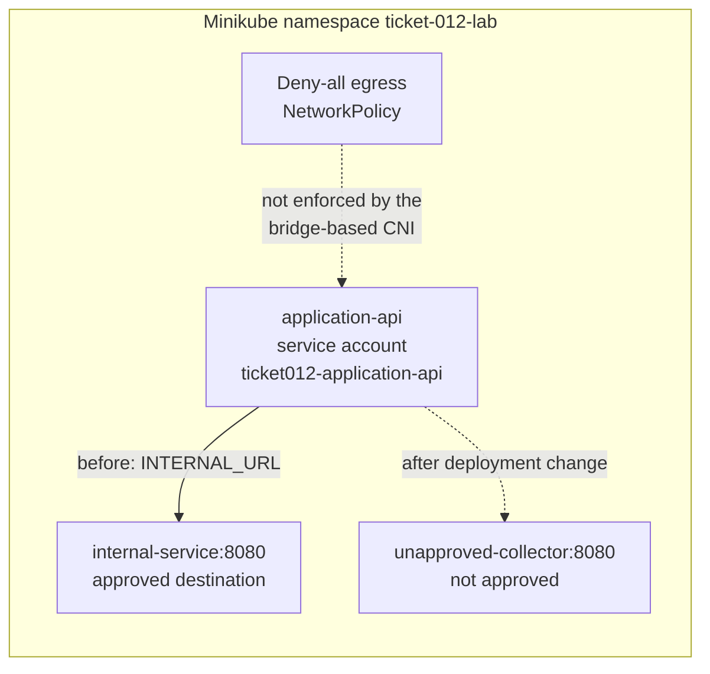
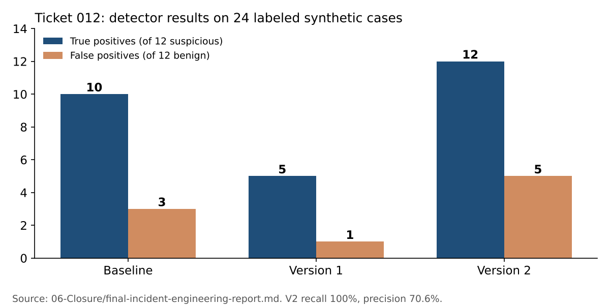

# Ticket 012 Diagrams

*Added November 27, 2026, after the ticket's technical work was completed. This file is a summary, not part of the original evidence, and is not listed in the ticket's manifests.*

These visuals summarize the [Ticket 012 README](README.md), the laboratory files in [`02-Laboratory/`](02-Laboratory/) and the closure report. They are kept in a separate file because the README is listed in the ticket's final evidence manifest.

## The Simulated Incident

The `application-api` Deployment was changed so its `INTERNAL_URL` pointed at `unapproved-collector` instead of the approved `internal-service`:

Two explanations were tested: a deployment automation mistake and an unauthorized change. Because the egress NetworkPolicy was not enforced, the production recommendation is NO-GO.

## Detector Results

Version 2 detected all 12 suspicious cases but raised 5 false positives on the 12 benign ones (recall 100%, precision 70.6%). Source: [`06-Closure/final-incident-engineering-report.md`](06-Closure/final-incident-engineering-report.md).
